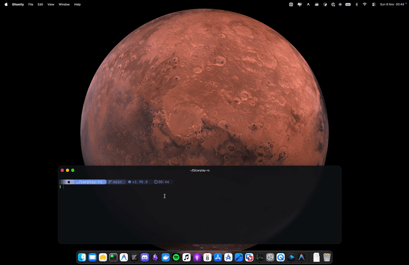

# CarPlay-RS

A pure **Rust** implementation of the Apple CarPlay protocol stack (wired via USB/NCM/USBMUX/iAP2 and wireless via 5 GHz Wi-Fi + Bluetooth/mDNS/AirPlay), designed for:

1. **Interactive Development and Testing on macOS / Linux Desktop** (`carplay-desktop`: native Cocoa/X11 window, hardware-accelerated H.264 High Profile decoding via Apple VideoToolbox on macOS with `openh264` fallback, low-latency 48 kHz stereo L16 audio playback via `cpal`, mouse mapped to Multitouch HID `0x2a2a2a2a`, keyboard/scroll mapped to Rotary Knob / Siri / Night Mode, and a built-in end-to-end simulated iPhone).
2. **Fast-Boot Embedded Linux Systems (< 2s boot time)** (`platform-embedded`: direct scanout to `/dev/fb0` / DRM `XRGB8888` & `RGB565` without X11/Wayland overhead, `evdev` Protocol B multitouch driver with screen rotation and calibration, V4L2 H.264/HEVC hardware decoders, and fast init / 5 GHz AP configuration generators for **Radxa Zero 3W (RK3566)**, **Orange Pi Zero 3 (H618)**, and **MangoPi MQ-Dual (T113-S3)**).

> [!IMPORTANT]
> **Status & Required Credentials**:
>
> - **Wi-Fi / Wireless CarPlay**: The wireless protocol stack (5 GHz AP configuration, mDNS service discovery, and BlueZ Bluetooth RFCOMM iAP2 bootstrap) is implemented, but **has not yet been validated end-to-end over Wi-Fi with a real device**.
> - **MFi Authentication Certificates**: To connect and authenticate with a physical iPhone, valid Apple MFi authentication certificates and private keys (`identity.pk8` and `certificate.p7b`, or a genuine hardware MFi coprocessor chip) are **strictly required and are NOT included in this repository**. You must provide your own certificates via `--mfi-local-dir <dir>` (or `./offline-mfi`), hardware I2C/CH341 chip, or `--mfi-server-url <url>`.

## Demo



> _Live demonstration of CarPlay-RS running on macOS: hardware-accelerated Apple VideoToolbox H.264 High Profile decoding (0% CPU, 60 FPS), low-latency 48 kHz stereo L16 audio, and interactive mouse-to-touch._

## Target Architecture: Desktop vs. In-Vehicle

- **`carplay-desktop` (Workstation Testing & Debugging Only)**:
  Exclusively designed for desktop development and debugging on macOS/Linux workstations. It runs inside an OS window (Cocoa/X11) with standard window borders, title bar, mouse-to-touch translation, and keyboard shortcuts. **It is not intended to run in the vehicle.**

- **`platform-embedded` (In-Vehicle Appliance / Kiosk)**:
  The production embedded head-unit software for vehicles (Raspberry Pi, Radxa, MangoPi). It runs directly against DRM/KMS or `/dev/fb0` with **zero window manager, no X11/Wayland, no borders or title bars (100% edge-to-edge full-screen)**, and reads capacitive touch directly from the Linux kernel input subsystem (`evdev`).

## Workspace Structure

| Crate                      | Responsibility                                                                                                                                                                                                                                                                                                                                                                                                                                                                 |
| -------------------------- | ------------------------------------------------------------------------------------------------------------------------------------------------------------------------------------------------------------------------------------------------------------------------------------------------------------------------------------------------------------------------------------------------------------------------------------------------------------------------------ |
| `crates/carplay-iap2`      | iAP2 Link Layer (`FF 55 02 00 EE 10` + `FF 5A` SYN/ACK/checksums), CSM framing (`0x4040`), Identification (`0x1D00..0x1D03`), MFi over iAP2 (`0xAA00..0xAA05`), wired session control (`0x4300`/`0x4301`/`0xAE03`), and wireless configuration (`0x5702`/`0x5703`/`0x4E0D`).                                                                                                                                                                                                   |
| `crates/carplay-mfi`       | `MfiAuthenticator` trait + physical I2C coprocessor support (`0x10`/`0x11` on `/dev/i2c-*` or USB CH341A adapter on macOS), remote HTTP/BAA signing server client (`/mfi/certificate`, `/mfi/sign`), and local P-256 ECDSA testing provider.                                                                                                                                                                                                                                   |
| `crates/carplay-airplay`   | `TLV8` codec, Apple Binary Plist codec (`bplist00`), RTSP/1.0 server, 3072-bit SRP-6a (`/pair-setup` PIN `"3939"`), X25519+Ed25519 (`/pair-verify`), `ControlCipher`, MFiSAP (`/auth-setup`), `/info`, `NtpClock` (UDP 210/211), `ScreenStream` (H.264/HEVC ChaCha20-Poly1305 + `avcC` -> Annex-B conversion), `AudioStream` (RTP ChaCha20-Poly1305), `IapTunnel` (stream 130), HID Touch/Knob/Media channel, and mDNS Bonjour (`_airplay._tcp` + `_carplay-ctrl._tcp` probe). |
| `crates/carplay-transport` | Apple USB discovery (`0x05AC`), Apple role switch / NCM vendor request (`0x52`), `NTB16` framing (`NTH16` + `NDP16`), Ethernet IPv6 + MAC rewrite in ICMPv6 Neighbor Advertisements, `USBMUX` v2 (`0xFEEDFACE` + pseudo-TCP port `62078`), `lockdownd` (`com.apple.carkit.service`), and 5 GHz `hostapd.conf` generation.                                                                                                                                                      |
| `crates/platform-embedded` | Embedded Linux backend: `EvdevMultitouchState` (`/dev/input/event*`), `LinuxFbdevSink` (`/dev/fb0` XRGB8888 and RGB565), fast `YUV420 -> XRGB8888 -> RGB565` conversion, and Buildroot fast-boot init scripts.                                                                                                                                                                                                                                                                 |
| `crates/carplay-desktop`   | Interactive desktop application for macOS and Linux + `--simulate-iphone`, `--usb-probe`, and `--self-test` modes.                                                                                                                                                                                                                                                                                                                                                             |

## Running and Testing on macOS

```bash
# 1. Run all workspace unit tests
cargo test --workspace

# 2. Run the end-to-end encrypted self-test (SRP-6a + PairVerify + MFiSAP + H.264 + RTP + HID)
cargo run -p carplay-desktop -- --self-test

# 3. Open the interactive window on macOS connected to the built-in simulated iPhone (Real H.264 + Touch + Audio)
cargo run --release -p carplay-desktop -- --simulate-iphone

# 4. Scan Apple USB devices connected to macOS (via libusb + usbmuxd)
cargo run -p carplay-desktop -- --scan-usb

# 5. Generate fast-boot (<2s) and 5 GHz Wi-Fi configs for Radxa Zero 3W / Orange Pi Zero 3 / MangoPi
cargo run -p carplay-desktop -- --print-embedded-config radxa
```

### Interactive Window Shortcuts (`carplay-desktop`)

- **Mouse Click / Drag**: Sends CarPlay Multitouch reports (`0x2a2a2a2a`) over the encrypted `eventPort` channel
- **Mouse Scroll / Left & Right Arrow Keys**: Rotates the Rotary Knob (`0x2a2a2a2b`)
- **`Enter`**: Knob center press (`Select`)
- **`H`**: CarPlay Home Button
- **`B` / `Backspace`**: Back Button
- **`S`**: Activates Siri (`requestSiri`)
- **`N`**: Toggles Day / Night Mode (`setNightMode`)
- **`T`**: Toggles the simulated H.264 iPhone on/off in real-time
- **`U`**: Scans Apple USB devices (`0x05AC`)
- **`D`**: Shows / hides the telemetry overlay (HUD)

## Support

If you find this project interesting or useful, please consider giving it a ⭐ **Star** on GitHub — it really helps the project reach more developers and enthusiasts!

## License

Licensed under either of:

- **Apache License, Version 2.0** ([LICENSE-APACHE](LICENSE-APACHE) or http://www.apache.org/licenses/LICENSE-2.0)
- **MIT License** ([LICENSE-MIT](LICENSE-MIT) or http://opensource.org/licenses/MIT)

at your option.

